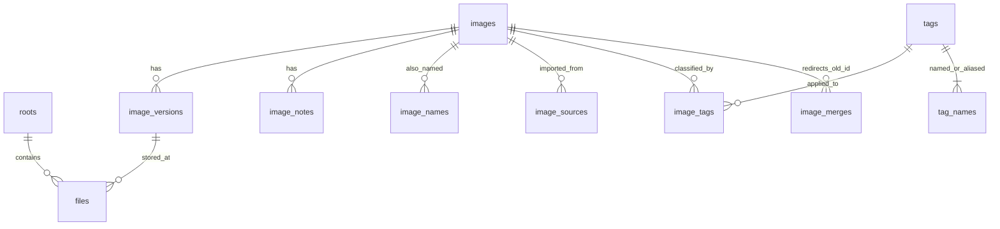

# Shared image catalog — proposal 1

Status: **design for review; not connected to the downloader**. The runnable
[schema](schema.sql) and [contract tests](../../tests/database_test.py) describe a
catalog shared by Download Helper, a future deduplicator, and a library manager.
The current release checks names directly on disk and keeps its existing JSON
history. There is no background import, hashing, or new database in the app yet.

## Existing designs reviewed

| Project | Useful precedent | Fit for this project |
| --- | --- | --- |
| digiKam | Album roots and relative paths; image IDs; separate comments; many-to-many image/tag relations | Good catalog model. Its full schema also serves a much larger photo application. |
| darktable | Image IDs and tag relations; tag synonyms; versioned migrations | Useful tagging model. Its database also contains extensive editing state and separates library and shared data. |

These are real existing schemas, not an absence of prior art. See digiKam's
[SQL definitions](https://github.com/KDE/digikam/blob/master/core/data/database/dbconfig.xml.cmake.in)
and darktable's [schema and migrations](https://github.com/darktable-org/darktable/blob/master/src/common/database.c).
My recommendation is an independent, smaller schema using these relational
patterns, with an explicit contract for our three writers. It is not binary
compatible with either application's database, and their migrations are not
copied. Directly adopting one would also couple all three apps to its unrelated
features and schema upgrades.

For eventual interchange with existing software, consider XMP sidecars. digiKam
explicitly supports importing metadata written by other tools through XMP;
sharing its private database is not required. [digiKam documentation](https://docs.digikam.org/en/getting_started/database_intro.html)

## Identity, content, and location

An **image** is the thing being described and tagged. An **image version** is one
immutable sequence of bytes. A **file** is a location containing a version. This
separation lets a rename preserve image ID 1234, lets two copies share metadata,
and lets an edit create version 2 without losing notes from version 1.

| Requested data | Representation |
| --- | --- |
| Filename | `files.name`, with `root_id + relative_path` identifying a location |
| Stable image ID | `images.id`; durable references use `(catalog.library_uuid, image_id)` |
| MD5 | `image_versions.md5`, 16-byte binary value; display with `hex(md5)` |
| Notes | Any number of `image_notes` rows referencing the image |
| Many tags | `image_tags` join table; one tag assignment per image/tag pair |
| Image synonyms | `image_names`, e.g. an alternative title or old filename |
| Tag synonyms | `tag_names`, e.g. “kitty” resolves directly to the tag whose canonical name is “cat” |

Both meanings of “synonyms” are supported. Tag synonyms refer to a tag ID, never
another synonym. One tag has exactly one canonical name; the writer creates the
tag and canonical name together. The database prevents duplicate canonical names,
alias ambiguity, duplicate assignments, and dangling foreign keys. The shared
writer must enforce the remaining “at least one canonical name” rule at commit.

IDs use `AUTOINCREMENT` so deleted IDs are not silently reused. Independent
imports can initially have different image IDs even if their bytes match. A
confirmed duplicate may be another `files` row on an existing version; merging
already-tagged images is a separate, explicit operation with metadata reconciliation.

## Folders, paths, and indexing

One local SQLite database per library can cover several roots, each recursively.
Store the database in the library manager's data directory; a root can be moved
without moving the database. Reject overlapping roots in the writer to avoid
indexing the same file twice. An offline root is not a deleted collection.

Store `/`-separated paths relative to a root, preserving the actual spelling.
`name` is the basename, not a second independently editable name. `path_key` and
`name_key` are produced by one shared path-normalization implementation. Probe
case sensitivity per root; do not assume that all macOS disks behave alike.
The exact Unicode/filesystem normalization needs platform fixtures before shipping.
SQLite SQL checks reject simple traversal/absolute paths; the writer must also
resolve filesystem containment and symlinks before reading or modifying files.
Default scanner policy: do not follow directory symlinks outside a root.

For human text keys (`tag_names.name_key`, `image_names.name_key`), use a pinned
Unicode NFC + full casefold implementation, not SQLite's ASCII-only default
`NOCASE`. Store original text alongside the key. This policy is distinct from
filesystem path identity and must have shared C++/other-language test vectors.

A scan updates file size/mtime and `last_seen_at`. Skip rehashing unchanged files
as a performance hint, but revalidate bytes before destructive deduplication.
Mark files missing only after a successful complete scan of an online root;
permission errors, interrupted scans, and disconnected drives must not cause a
mass deletion. Keep metadata for missing files. Index `root_id, name_key, state`
for recursive filename lookup. A name match can return several paths; it does
not establish content equality or authorize overwriting a file in a subfolder.

Before applying an existence result, verify the relevant path on disk. Watcher
events improve freshness but do not replace reconciliation scans. Today's
`filesStatus` protocol can keep returning the same shape when a catalog lookup
is introduced; policy for multiple recursive matches needs a separate UI decision.

## Hashing, deduplication, and edits

MD5 is required for compatibility/search, but it is not a unique ID or sufficient
proof for deleting a duplicate. Store full-file MD5 and SHA-256 while streaming
bytes once. Hashes are nullable for files waiting to be indexed and deliberately
non-unique. Candidate search is `(byte_size, md5)`; destructive dedup must verify
current files with a stronger hash and a byte comparison. A perceptual hash would
belong in a later, algorithm-versioned similarity table, never the MD5 column.

Edits create a new `image_versions` row under the same image ID. Update the file's
`version_id` only after the replacement is safely saved. Byte identity fields are
immutable after computation; filling a previously NULL hash is allowed. Keeping
old version metadata does not retain old bytes: undo requires keeping an old file
copy as well. An unrelated overwrite creates a new image identity unless the user
explicitly identifies it as an edit; do not silently attach old tags to new art.

Deduplication can remove a redundant file location while retaining the image's
notes and tags. A metadata merge unions tag assignments, preserves notes and
alternative names, reassigns versions with fresh per-image version numbers, and
records `image_merges(old_image_id, kept_image_id)`. Tombstone the old image;
reject cycles and flatten previous redirects in the same transaction. Never
physically delete a file simply because its row was deleted.

## Three applications using one database

Ship a small shared catalog library (connection setup, migrations, normalization,
transaction helpers, and query contract) before implementing three independent
writers. SQLite is the durable common format; UI code must not invent its own
updates. Every connection sets `foreign_keys=ON`, `busy_timeout=5000`, and
`synchronous=FULL` before work. Verify the pragma values. Use WAL on a local disk,
short transactions, and bounded retries for `SQLITE_BUSY`. Readers can coexist
with a writer, but there is still only one writer at a time. Do not share a live
WAL database through a network drive or sync service. [SQLite WAL](https://sqlite.org/wal.html),
[connection pragmas](https://sqlite.org/pragma.html)

Runtime requirement before integration: use SQLite 3.51.3+ or a release containing
the documented WAL-reset fix (backports include 3.44.6 and 3.50.7). Check the SQLite
version actually linked by Qt, not just a system CLI version. This draft's SQL
uses `STRICT` tables (3.37+), but syntax compatibility alone is insufficient for
three concurrent production apps. [SQLite WAL-reset fix](https://sqlite.org/wal.html#walresetbug)

Use `BEGIN IMMEDIATE` for short mutations. Do hashing, HTTP, file copying, and
image processing outside a write transaction. For edits, update using an expected
revision, e.g. `UPDATE image_notes SET body=?, revision=revision+1 WHERE id=? AND
revision=?`; zero changed rows means refresh/resolve the conflict. Image metadata
operations also increment `images.revision` and update `updated_at` in the same
transaction. Tag-name changes increment `tags.revision`. These are writer-contract
rules, not automatic triggers in this draft.

Initially, each app can compare `PRAGMA data_version` on its own long-lived read
connection to invalidate cached queries after another connection commits. Reload
affected views when it changes; handle the app's own commits directly. A durable
fine-grained change feed can be added when needed. [SQLite data_version](https://sqlite.org/pragma.html#pragma_data_version)

`application_id` identifies this format; `user_version` identifies the migration
level. All apps must check both before writes and refuse unknown newer schemas.
Migrate with all three apps closed, under one cross-process maintenance lock,
a verified backup, and one transaction per migration. Never let each application
race to upgrade an open catalog. Test upgrades on populated fixtures and run
`foreign_key_check`/`quick_check`. Use SQLite's backup API (or a fully closed,
checkpointed database), not a live copy of only the `.sqlite` file.

## Filesystem operations and crash recovery

A SQL transaction cannot make a filesystem rename atomic with a database commit.
Before integrating overwrites, moves, or dedup deletion, add a durable operation
journal and per-path reservations shared by all three apps. Proposed journal
fields: operation UUID, kind, source/destination root+path, expected version/hash,
staging or quarantine path, phase, timestamps, and diagnostic error. Enforce one
active reservation per normalized path. This journal is intentionally a next
migration, not a false promise of crash safety from the catalog tables alone.

The future sequence is: reserve and record intent in a short transaction; stage
and validate bytes outside it; atomically rename (or move duplicates to quarantine);
commit catalog changes and mark the operation complete. On restart, reconcile
unfinished operations against hashes and actual paths; never guess that “missing
source” means a safe deletion. Keep quarantine until user review/retention expiry.
A reconciliation scan recovers downloads saved before their catalog commit.

## Review and implementation order

1. Review the identity/version/file split and the two meanings of synonyms.
2. Freeze path/text normalization fixtures and the shared catalog API.
3. Implement migrations, indexing, read-only queries, and multi-app conflict tests.
4. Connect the downloader's existing filename-status interface to the catalog.
5. Implement operation journaling before destructive deduplication or editing.
6. Add XMP interchange, thumbnail caches, and full-text search only when needed.

The current schema tests exercise multiple file locations, aliases, referential
integrity, hash collisions, versioned edits, and conflict handling. They validate
the proposal; they do not make it a deployed database subsystem.
